# ONIKA GOBANE
## GitHub Student Account Evidence
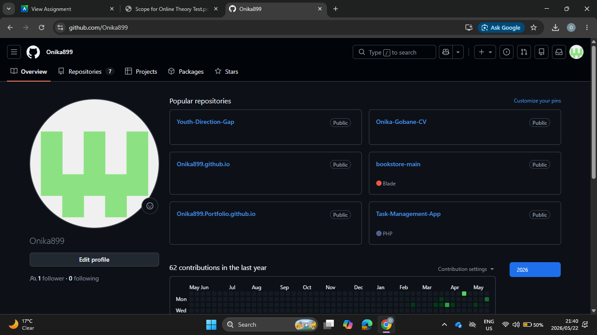

## CV Coded Using Markdown Language Evidence
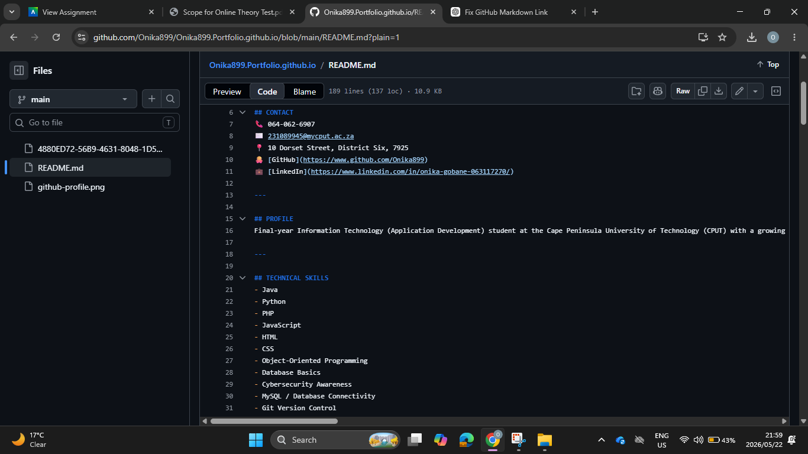
## CONTACT
📞 064-062-6907  
✉️ 231089945@mycput.ac.za  
📍 10 Dorset Street, District Six, 7925  
🐙 [GitHub](https://www.github.com/Onika899)  
💼 [LinkedIn](https://www.linkedin.com/in/onika-gobane-063117270/)  

---

## PROFILE
Final-year Information Technology (Application Development) student at the Cape Peninsula University of Technology (CPUT) with a growing passion for software and web application development. Enjoy creating functional digital solutions and designing user-friendly interfaces that enhance overall user interaction. Currently seeking an internship or junior developer role where I can apply my programming, database, and UI/UX design skills while developing practical industry experience.

---

## TECHNICAL SKILLS
- Java  
- Python  
- PHP  
- JavaScript  
- HTML  
- CSS  
- Object-Oriented Programming  
- Database Basics  
- Cybersecurity Awareness  
- MySQL / Database Connectivity  
- Git Version Control  
- Blockchain and Cryptocurrency  
- User Interface (UI) Design  

---

## EDUCATION
**Cofimvaba High School**  
Matric (Grade 12) – Completed 2022  

**Cape Peninsula University of Technology (CPUT)**  
Higher Certificate in Information & Communication Technology – Completed 2024  

**Cape Peninsula University of Technology (CPUT)**  
Diploma in ICT: Application Development – Final Year  

---

## PROJECT EXPERIENCE

### CPUT Admission Tracking System (Project Manager) – 2025  
**Technologies:** Java, Java Swing, JDBC, MySQL  

- Led a development team in designing an Admission Tracking System to manage student application data.  
- Developed GUI components and contributed to system architecture using object-oriented programming principles.  
- Implemented database connectivity and supported documentation, reporting, and authentication features.  

### Capitec Mobile Banking App Redesign Prototype (Design Leader) – 2025  
**Tools:** Figma, UI/UX Design  

- Created high-fidelity prototypes for key features including dashboard, transactions, payments, and profile management.  
- Applied user-centered design principles and coordinated design improvements based on feedback and iteration.  

---

## REFERENCES
**Nomonde Jekeqa** – 072 965 9797  
**Mangqegelana Sinethemba** – 079 079 3680  

---

🎥 **Mock Interview Video**  
<video width="600" controls>
  <source src="4880ED72-56B9-4631-8048-1D59070CD55B.mp4" type="video/mp4">
</video>

---

## Reflection: Coding My CV Using Markdown (STAR Method)

### Situation  
I was required to create and present my CV using GitHub Flavoured Markdown for my digital portfolio. This meant moving away from traditional word-processing tools and approaching the CV as a structured document written in code. It was a new experience because I had to think like a developer, focusing on syntax, structure, and consistency rather than relying on visual formatting. This was important because it prepared me for industry practices where Markdown and GitHub are widely used for documentation and professional presentation.

### Task  
My task was to transform my CV into a professional, well-structured, and readable Markdown document that displayed correctly on GitHub. It needed to include all key sections such as contact details, profile, technical skills, education, project experience, and references, while maintaining a clean and consistent layout suitable for potential employers. Beyond the assessment, the CV also needed to be shareable online, giving me a professional link I could use for job applications.

### Action  
- Planned the CV structure by outlining sections in a logical order for clarity.  
- Learned and applied Markdown syntax including headings, bullet lists, bold text, and horizontal rules.  
- Wrote concise project descriptions highlighting my role and the technologies used.  
- Uploaded the `README.md` file to GitHub, previewed the rendering, and fixed spacing and indentation issues.  
- Used Git commits with clear messages to track changes and maintain version history.  
- Iterated multiple times to refine formatting and ensure the CV looked consistent across GitHub Pages.  
- Focused on readability and professional tone, ensuring the CV could be understood easily by both examiners and potential employers.  

### Result  
The final CV was clean, structured, and professional. It displayed correctly on GitHub and was easy to read online. This process improved my documentation skills, strengthened my attention to detail, and increased my confidence in using Git and GitHub for professional presentation. It also prepared me for industry practices where Markdown and version control are commonly used. Most importantly, I now have a shareable CV link that I can use for job applications, making my portfolio accessible beyond the classroom.

---

## What Was Easy and What Was Difficult

**Easy**  
- Organising content into sections.  
- Learning and applying basic Markdown syntax.  
- Using GitHub’s preview feature to quickly identify formatting issues.  
- Updating content quickly without worrying about formatting styles.  

**Difficult**  
- Managing spacing and line breaks to ensure correct rendering.  
- Keeping formatting consistent across all sections.  
- Deciding how much detail to include in project descriptions without making the CV too long.  

---
## Mock Interview Video Reflection (STAR Method)

### Situation  
As part of my digital portfolio, I was required to record and include a mock interview video. This video was important because it demonstrates my communication skills, confidence, and readiness for a professional work environment. Beyond the assessment, it also gave me the opportunity to practice professional communication and showcase my readiness to potential employers.

### Task  
My task was to prepare for the interview, record a clear and professional video, and upload and embed it into my GitHub Pages portfolio so that it could be viewed directly online. The video needed to be accessible, reliable, and presented in a way that reflected my professionalism.

### Action  
- Prepared by practicing common interview questions to ensure that my answers were clear, relevant, and well-structured.  
- Recorded the video in a quiet environment, making sure that the audio was clear and the lighting was suitable.  
- Saved the video in MP4 format so it would be supported on web platforms.  
- Uploaded the video file correctly into my repository and used an HTML `<video>` tag in my `README.md`.  
- Ensured the file path and filename were correct to avoid playback errors.  
- Waited for GitHub Pages to deploy the changes and tested the video on the live site.  
- Troubleshot issues such as incorrect file paths, delays in deployment, and playback errors.  
- Verified the video worked consistently across different browsers and devices.  

### Result  
The mock interview video was successfully embedded into my portfolio and plays correctly on GitHub Pages. The final outcome demonstrates both my communication skills and my ability to present work professionally online. Through this experience, I improved my confidence in speaking, developed better preparation techniques for interviews, and gained practical experience in handling and embedding media content in a web-based portfolio. I now have a professional video embedded in my portfolio that I can share with potential employers. This process also strengthened my problem-solving skills and ability to work independently when facing technical challenges.

---

## What Was Easy and What Was Difficult

**Easy**  
- Preparing and practicing interview answers was straightforward.  
- Recording the video was manageable with a quiet environment and proper lighting.  

**Difficult**  
- Uploading and embedding the video on GitHub took time.  
- Fixing file path issues and ensuring correct display.  
- Waiting for GitHub Pages to redeploy changes.  
- Troubleshooting playback issues through multiple attempts.  
- Ensuring the video worked consistently across different browsers and devices.  

---

## Published on GitHub Pages Evidence

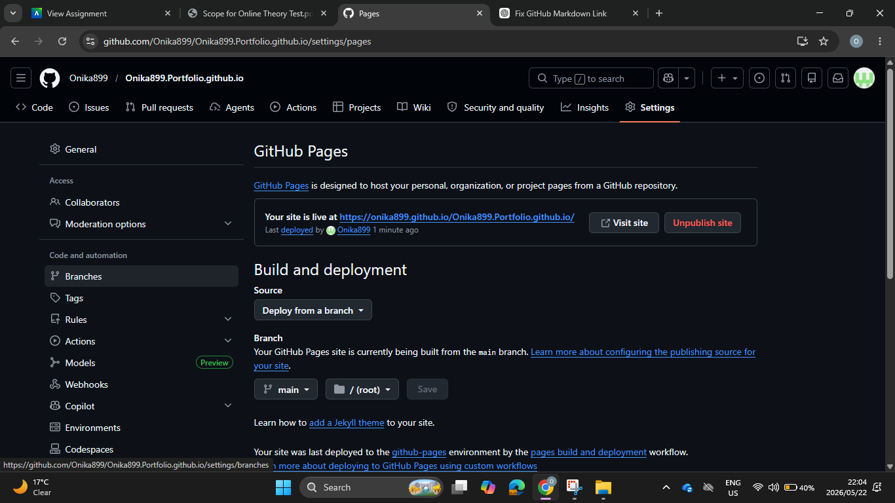

# Reflection: Using GitHub Pages (STAR Method)

## Situation  
I was required to publish my digital portfolio, including my CV and a mock interview video, so that examiners and potential employers could access it online. The assessment specification stated that the portfolio had to be hosted using **GitHub Pages**, which meant I needed to learn how to deploy a repository as a live website. This was new to me because I had only used GitHub for storing code and commits before, not for hosting a site. I had to ensure that both text-based content (Markdown CV) and media files (mock interview video) displayed correctly once published.

## Task  
My task was to prepare a GitHub repository for publishing, organise and upload all portfolio files (including a `README.md` CV and video content), configure GitHub Pages to deploy from the correct branch, embed the mock interview video so it would play on the live site, and verify that the final website was fully accessible and displayed correctly. I also needed to document my process and reflect on what I had learned, since this was part of the assessment requirements.

## Action  
- Created a GitHub repository named `username.github.io` and wrote my CV in Markdown in the `README.md` file.  
- Uploaded the mock interview video and other supporting files using clear filenames and meaningful commit messages (e.g. *Add mock interview video*, *Update CV content*).  
- Embedded the video in the `README.md` using an HTML `<video>` tag and ensured the file path matched exactly.  
- Configured GitHub Pages in the repository settings and selected the main branch as the publishing source.  
- Troubleshot issues by correcting file name/path errors and compressing the video when upload issues occurred.  
- Re-committed changes and checked the live site after each update.  
- Tested the site on different browsers and devices to ensure consistent performance and layout.  

## Result  
The portfolio was successfully deployed using GitHub Pages and is accessible via a live URL. The CV displays correctly and the mock interview video plays as intended. This created a professional online portfolio suitable for submission and job applications. The process improved my understanding of version control, repository management, and static website deployment. It also gave me a shareable link that I can now use beyond the assessment, making my portfolio accessible to employers and peers.

---

## What was easy  
- Creating the repository and writing the CV in Markdown was straightforward.  
- Git commits made it easy to track and correct changes.  
- The GitHub preview feature provided quick feedback on formatting.  

## What was difficult  
- Uploading large video files required compression.  
- File path and naming errors caused initial playback issues.  
- Deployment delays meant waiting for changes to reflect live.  
- Ensuring consistent layout across browsers and devices required extra testing.   
- Testing across different devices and browsers required extra time.

---
---

# AGILE PORTFOLIO: PARTLINK PROJECT

**Project:** PartLink, a digital marketplace for verified car parts in Khayelitsha  
**Subject:** Project Presentation 3 (PRP370S / PRP371S / PRP372S)  
**My role:** Writer (as listed in our team charter) and Team Lead from 4 August 2026  
**Submission date:** 27 October 2026  
**Last updated:** 27 October 2026  

**Contents:** [Agile Team Charter](#agile-team-charter-partlink-project) | [User Stories and Tasks](#user-stories-and-tasks-partlink-project) | [Product Backlog](#product-backlog-partlink-project) | [Sprint Backlog](#sprint-backlog-partlink-project) | [Agile Logbook](#agile-logbook-partlink-project)

## About the project
PartLink is a mobile-first digital marketplace that connects vehicle owners, mechanics and small transport operators in Khayelitsha with verified car parts sellers. Our community survey found that residents lose between 30 minutes and several hours (and sometimes days or weeks) finding the right part, and travel anywhere from 10 to 15 km to more than 100 km to get it. Buyers also worry about low-quality and stolen parts. To plan, build and track the project we used Agile methods: a Kanban board on Trello, short sprints, daily stand-ups and a logbook. The five sections below show how our team worked, and each one has evidence followed by my reflection.

**Project status (27 October 2026):** the PartLink website has been fully coded and deployed, and it is working. The sections below record how we planned, built and tracked it. Every card in Sprints 5 to 10 on our Trello board shows a completed checklist. The logbook entries cover the front-end build (28 July to 7 August 2026) in detail, and the team completed the remaining work after that.

---

# Agile Team Charter (PartLink Project)

## Evidence: Team Charter

An Agile team charter is a shared agreement that sets out a team's purpose, values, working agreements and boundaries, so that everyone knows how the team will work before the work starts. Ours is a signed document that every member committed to.

- **Objective:** To develop and launch PartLink, a trusted digital marketplace connecting vehicle owners, mechanics and small transport operators in Khayelitsha with verified car parts sellers.  
- **Success definition:** PartLink reduces the time it takes to source car parts, improves accessibility, and gives users reliable connections to verified sellers.  
- **Team members:** Hillary Itlhabanyeng, Inam Klaas, Onika Gobane, Siphesihle Khinase, Sesethu Nciti, Nondumiso Ngobese, Liyabona Ngece.  
- **Document evidence:** [View Agile Team Charter](./Agile%20Team%20Charter%20%281%29.docx)

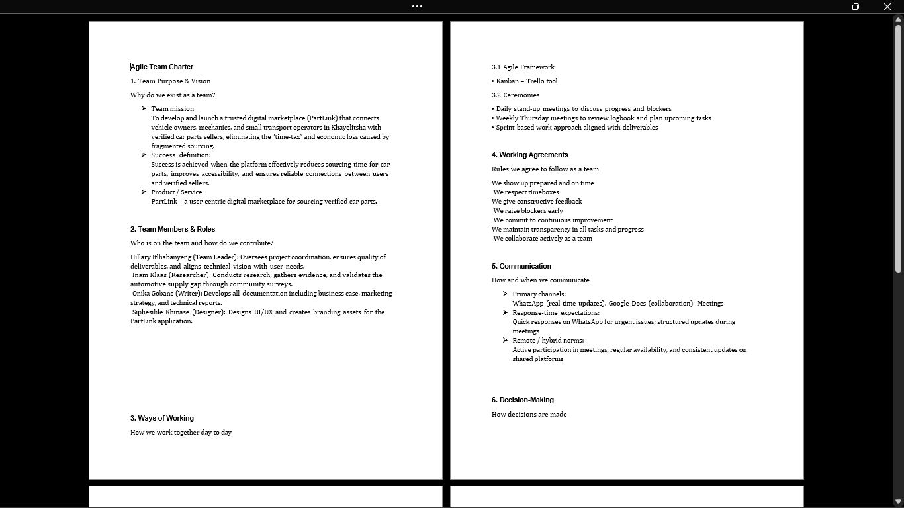
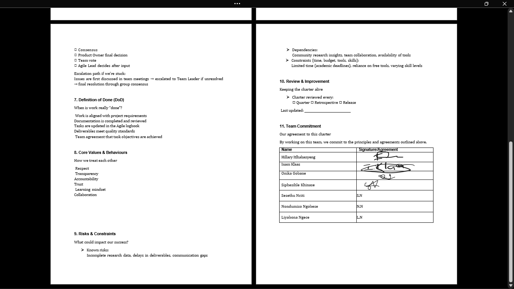

### The charter at a glance

| Section | What we agreed |
| --- | --- |
| **Roles** | Team Leader (Hillary), Researcher (Inam), Writer (Onika), Designer (Siphesihle). The Team Leader coordinates the project and aligns the vision with user needs; the Researcher gathers and validates evidence; the Writer produces the documentation; the Designer creates the UI/UX and branding |
| **Ways of working** | Kanban managed on Trello; daily stand-ups to discuss progress and blockers; a weekly Thursday meeting to review the logbook and plan upcoming tasks |
| **Working agreements** | Show up prepared and on time; respect timeboxes; give constructive feedback; raise blockers early; commit to continuous improvement; stay transparent about tasks and progress; collaborate actively |
| **Communication** | WhatsApp for real-time updates, Google Docs for collaboration, and meetings for structured updates. Urgent issues get quick responses on WhatsApp |
| **Decision-making** | Decisions are discussed in team meetings first. If we are stuck they go to the Team Leader, and the final resolution is by group consensus |
| **Definition of Done** | Work is aligned with requirements, documentation is completed and reviewed, tasks are updated in the Agile logbook, deliverables meet quality standards, and the team agrees the objectives are achieved |
| **Core values** | Respect, transparency, accountability, trust, learning mindset, collaboration |
| **Risks** | Incomplete research data, delays in deliverables, communication gaps |
| **Constraints** | Limited time because of academic deadlines, reliance on free tools, and varying skill levels |

### Changes after the charter was written
The charter was written with Hillary as Team Leader. On 4 August 2026 Hillary left the group and I became team lead, and on 7 August Liyabona Ngece joined the team. The roles table in the charter has not yet been updated to show these changes.

## Reflection: Agile Team Charter (STAR Method)

### Situation  
Our assessment required each team to agree how it would work before building anything. Our team had come together to solve a real problem in Khayelitsha: people struggle to find affordable, reliable car parts quickly and safely. Seven of us signed the charter, and my role in the team was Writer, so the charter was part of the documentation I was responsible for. It mattered because it was the document the rest of our Agile practice depended on, including the stand-ups, the weekly Thursday review, the Trello board and our Definition of Done.

### Task  
My task was to take part in creating the charter and commit to it. The charter had to cover our purpose and success definition, who does what, how we communicate and make decisions, what "done" means, and the risks we could see coming. As Writer, I wrote up the charter with the team's agreements, so that it was clear, complete and easy for every member to follow.

### Action  
- Wrote up the charter document, covering our purpose, roles, working agreements, communication, decision-making and the Definition of Done.  
- Recorded the team's mission and what success looks like, so that every task could be checked against the same goal.  
- Documented the four roles and what each one is responsible for, so that the research, writing, design and leadership work had clear owners.  
- Wrote down the working agreements (turning up prepared, respecting timeboxes, raising blockers early, giving constructive feedback) so they could be used to hold each other accountable.  
- Set out how we communicate (WhatsApp, Google Docs and meetings) and an escalation path for decisions: team meeting, then Team Leader, then group consensus.  
- Listed the risks and constraints we could already see, such as incomplete research data, tight academic deadlines and free tools.  
- Put the charter into practice through our daily stand-ups and the weekly Thursday review.  
- When Hillary left the group on 4 August 2026, I stepped up as team lead and the team regrouped. I updated the Trello board to reflect the new plan and reassigned her outstanding cards across the team.  

### Result  
The charter gave us shared rules from the start, and our logbook shows them being used. Stand-ups were recorded every working day from 28 July to 7 August, and each entry lists the team's impediments, which is the "raise blockers early" agreement in action. When the team changed on 4 August we regrouped quickly: we agreed a lead, reassigned cards and kept the sprint moving. The charter gave us a way to handle that change calmly instead of letting the project stall. The change also showed me that a charter has to be kept up to date, because the roles in it no longer matched the team after Hillary left and Liyabona joined. Next time I would update the roles table on the same day the team changes. I would also tighten the decision-making section, which lists several methods (consensus, team vote, Product Owner and Agile lead), by stating which one the team uses most.

---

## What Was Easy and What Was Difficult

**Easy**  
- Writing up the charter once the team had agreed its values and working agreements. Most of the content came from decisions the team had already made, so my job was to record it clearly.  
- Organising the charter into clear sections (purpose, roles, ways of working, communication, decisions, Definition of Done, risks), which made it simple to follow and to refer back to.  

**Difficult**  
- Keeping the charter and our other documents up to date as the team changed. When Hillary left and Liyabona joined, the Trello board, logbook and charter all needed to show the same team, and updating all three at the same time took extra effort.  
- Making sure every document told the same story. A marker or teammate reading the charter should see the same roles and team as in the logbook, so I had to check them against each other.  

---

# User Stories and Tasks (PartLink Project)

## Evidence: User Stories and Task Breakdown

A user story is a short description of a feature written from the end user's point of view, in the format *As a [user], I want to [goal], so that [benefit]*. Each story is then split into tasks the developers can build.

- **Overview:** Based on our community survey, we wrote 22 user stories, each with acceptance criteria and tasks.  
- **Priorities (MoSCoW):** 11 Must, 8 Should and 3 Could.  
- **User groups:** car owners, mechanics, small transport business owners, sellers, car enthusiasts and administrators.  
- **Document evidence:** [View PartLink User Stories PDF](./PartLink_User_Stories.pdf)

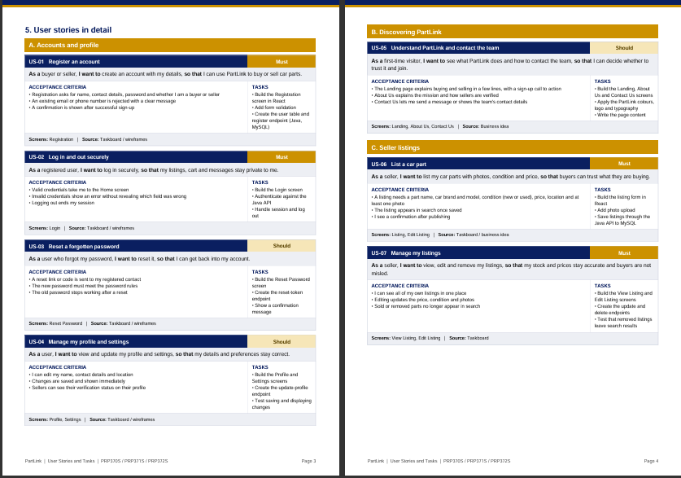

### How the 22 stories are organised

| Area | Stories | Examples |
| --- | --- | --- |
| Accounts and profile | 4 | Register, log in, reset a password, manage a profile |
| Discovering PartLink | 1 | Understand PartLink and contact the team |
| Seller listings | 2 | List a car part, manage my listings |
| Finding and buying parts | 6 | Search, filter, view details, compare prices, cart, secure checkout |
| Needs of specific users | 4 | Find parts near me, get a vehicle back on the road, notifications, request a part |
| Trust and safety | 5 | Message a seller, verified sellers, verify sellers, ratings and reviews, report a listing |

### Key user story examples

1. **US-06: List a car part (Must).** *As a seller, I want to list my car parts with photos, condition and price, so that buyers can trust what they are buying.*  
   - *Acceptance criteria:* a listing needs a part name, brand and model, condition, price, location and at least one photo; it appears in search once saved.  
   - *Tasks:* build the listing form in React, add photo upload, save listings through the Java API to MySQL.  
2. **US-09: Filter results (Must).** *As a buyer, I want to filter car parts by brand, model and price, so that I can quickly find what I need.*  
   - *Acceptance criteria:* filters can be combined; a minimum and maximum price can be set; a clear-all option resets the filters.  
   - *Tasks:* build the filter controls, pass filters to the search endpoint, test filter combinations.  
3. **US-14: Find parts near me (Should).** *As a mechanic, I want to see which parts are available near me, so that I can finish repairs on time and keep my customers.*  
   - *Acceptance criteria:* listings can be filtered or sorted by location or distance; each listing shows its availability.  
   - *Tasks:* add a location field to listings, build the location filter and sort, test with listings from different areas.  
4. **US-19: See which sellers are verified (Must).** *As a buyer, I want to see which sellers are verified, so that I avoid scams, low-quality parts and stolen parts.*  
   - *Acceptance criteria:* a verified badge shows on listings and profiles; unverified sellers are clearly labelled.  
   - *Tasks:* add a verified flag to the seller record, build the badge component, show the badge on details and profile screens.  

## Reflection: User Stories and Tasks (STAR Method)

### Situation  
Our community survey (21 responses) gave us strong evidence of the problem. Most respondents owned a vehicle or ran a repair shop, and they reported spending anywhere from 30 minutes to several hours, and sometimes days, getting a part. Their biggest frustrations were stock shortages, long distances, high prices and doubts about quality, and 90% said they would pay for convenience if parts were guaranteed to be in stock locally. Our business idea of a mobile app with verified sellers, reviews, secure payment and notifications was a direct answer to that. As the team's Writer, I used the survey and our business case to understand who needs PartLink and why, and the next step was to turn that into work the team could plan and build.

### Task  
My task was to help turn our research and business idea into user stories from the buyer's and seller's point of view, with acceptance criteria that say when a story is finished and tasks that the team could take on for the React front-end, Java back-end and MySQL database. I wrote up the stories and their acceptance criteria in our documentation, so that every member could see what each screen and feature needed.

### Action  
- Went back to the survey results and business case to identify who PartLink serves: car owners, mechanics, small transport business owners, sellers, car enthusiasts and administrators.  
- Wrote 22 stories in the "As a... I want to... so that..." format, so that each one states a user, a goal and a benefit.  
- Grouped the stories into six areas (accounts, discovering PartLink, seller listings, finding and buying parts, needs of specific users, and trust and safety) to keep the list organised.  
- Added two to three acceptance criteria to each story, so the team can test whether the story is really finished.  
- Broke each story into tasks, such as building a screen in React, creating an endpoint in Java and saving data in MySQL.  
- Prioritised the stories using the MoSCoW method: 11 Must, 8 Should and 3 Could.  
- Linked each story to the screens in our 17-screen wireframe set, so that design and build work could be traced back to a story.  
- Documented everything in a PDF with acceptance criteria and tasks, so the whole team could see what each screen needed.  

### Result  
The stories gave the team clear direction and linked our build work to what the survey found. The logbook shows this in practice: the Registration and Login screens built on 30 July match US-01 and US-02, the Home/Products and Car Part Listing screens built on 29 and 31 July match the search, filter and listing stories (US-06, US-08, US-09), and the Cart and Checkout screens built on 31 July match US-12 and US-13. Writing stories also made me think about trust and safety early, which is why verified sellers are a "Must". Looking back, I would estimate the tasks in each story before the sprint starts, so large stories are split into tasks that fit in a day. A few stories, such as admin review, notifications and chat, do not yet have a screen in our 17 wireframes, so the design would need to be extended before they are built.

---

## What Was Easy and What Was Difficult

**Easy**  
- Writing stories for buyers and sellers, because our survey and business case had already shown what they need. The pain points (time, distance, stock, price and trust) turned directly into goals and benefits.  
- Using the "As a... I want to... so that..." format, which kept each story short and focused on the user.  

**Difficult**  
- Splitting large stories, such as the whole front-end, into small tasks that could be finished in a day.  
- Keeping the stories, Trello cards and documents consistent with each other. When the plan changed (for example the lecturer's colour palette request on 31 July), the story list, the board and the logbook all had to be updated to match.  

---

# Product Backlog (PartLink Project)

## Evidence: Product Backlog Board

A product backlog is a prioritised list of all the work a product needs, including features, fixes and improvements. Ours is managed on a Trello Kanban board and ordered by sprint, from research through to back-end integration.

- **Live board:** [PartLink Trello Board](https://trello.com/b/PmNt1Ast/parklink)  
- **Board structure:** one list per sprint, with a daily card for each day and a checklist of tasks on every card. The full sprint plan is in the Sprint Backlog section.  
- **Sprints:** the board is divided into ten sprints, and Sprints 5 to 10 are shown in the Sprint Backlog section. Our logbook's taskboard snapshot used an earlier sprint numbering, so the sprint numbers in the table below follow the final Trello board.

**Status as at 27 October 2026:** all core backlog items are complete, and the PartLink website is deployed and working.

| Priority | Backlog item | Sprint | Status |
| --- | --- | --- | --- |
| 1 | Community research, survey and business case (validated and presented) | Earlier sprints | Complete |
| 2 | User stories | Sprint 5, Day 1 | Complete |
| 3 | Product backlog | Sprint 5, Day 2 | Complete |
| 4 | MVP planning and development: scope and tech stack (React, Java, MySQL) | Sprint 5, Days 3 and 4 | Complete |
| 5 | Wireframe planning and wireframes for all 17 app screens | Sprint 6 | Complete |
| 6 | Front-end development in React: all 17 wireframed screens | Sprint 7, Day 1 | Complete |
| 7 | Colour palette page (assigned by our lecturer) | Added during the front-end build | Complete |
| 8 | Database design (MySQL) | Sprint 7, Day 2 | Complete |
| 9 | Java back-end development (IntelliJ IDEA) | Sprint 7, Day 3 | Complete |
| 10 | Authentication | Sprint 8, Day 1 | Complete |
| 11 | User testing requirements and system testing | Sprint 8, Days 2 and 4 | Complete |
| 12 | Updated risk analysis | Sprint 8, Day 3 and Sprint 9, Day 1 | Complete |
| 13 | Collect feedback and final UI improvements | Sprint 9, Days 2 and 3 | Complete |
| 14 | Sprint retrospective | Sprint 9, Day 4 | Complete |
| 15 | Final documentation, and final project presentation and demonstration | Sprint 10, Days 1 and 2 | Complete |
| 16 | Deployment and closure (the PartLink website is live) | Sprint 10, Day 3 | Complete |
| 17 | Optional: Requests and Create Car Part Request screens | Optional | Optional |

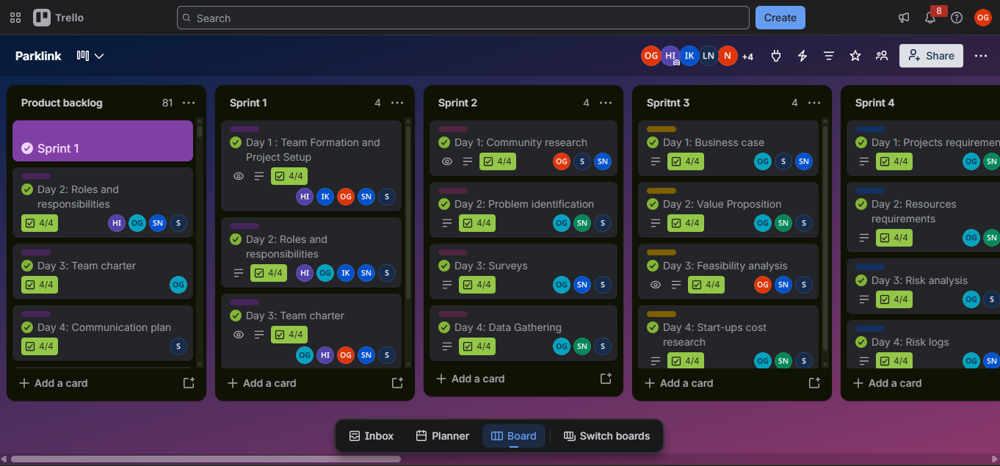

### Why the backlog is ordered this way
Research and validation come first, because there was no point designing a solution before we had proved the problem was real. User stories, the product backlog and the MVP plan come next, followed by the wireframes, so that development has a clear plan. Front-end development, database design and the Java back-end follow the wireframes. Authentication, testing, risk analysis and user feedback come after the build, and the project closes with final documentation, the final presentation and demonstration, and deployment. The Requests screens are optional, because the app works without them.

## Reflection: Product Backlog (STAR Method)

### Situation  
Our project covered research, design and development, and the work was spread across seven team members. Without one list of everything the project needed, it would have been easy to lose track of what was finished, what was being worked on and what was still to come. Our work covered research, design and development, so it had to be tracked in one place, and the Trello Kanban board became our product backlog.

### Task  
My task was to help build and maintain the backlog on Trello, prioritise it, and keep it aligned with our user stories. I updated the board as work moved and kept it consistent with our documents, so that anyone in the team could open it and see the true state of the project.

### Action  
- Organised the work into ten sprints of three or four daily cards, from research and planning to deployment and closure.  
- Kept the board up to date by ticking off each card's checklist as the work was done. Every card in Sprints 5 to 10 now shows a completed checklist, from user stories and wireframes to authentication, testing and deployment.  
- Added the colour palette page to the backlog after our lecturer asked for it on 31 July 2026, so the new request was visible and tracked.  
- After Hillary left on 4 August 2026, updated the board to match the new plan and reassigned her outstanding cards. I reassigned them across the three remaining members so that work could continue.  
- Updated the board again on 7 August 2026 when Liyabona joined, so that she could see the project history and her upcoming back-end tasks.  
- Kept the board and our documents in step with each other as work was completed.  

### Result  
The backlog gave the team full visibility of what was done, in progress and still to do. For example, on 4 August the board showed Hillary's outstanding cards, so we could share them across the team instead of losing that work. It also showed new members what had already been completed and what came next. Next time I would add effort estimates to each backlog item before the sprint starts, and I would split large items such as "front-end development in React" into smaller cards, so that progress is easier to measure.

---

## What Was Easy and What Was Difficult

**Easy**  
- Moving cards across the Kanban columns and seeing progress straight away, because the board showed the state of the project at a glance.  
- Ordering the backlog by sprint, because the project followed a natural path from research to design to build.  

**Difficult**  
- Keeping the board and documents up to date at the same time. Every change to the plan, such as the lecturer's request or the team change, meant updating Trello, the logbook and sometimes the charter or stories, and it was easy for one of them to fall behind.  
- Keeping the board accurate when the team changed and work had to be reassigned, because each card had to be checked and given to the right person.  

---

# Sprint Backlog (PartLink Project)

## Evidence: Sprint Backlogs

A sprint backlog is the actionable plan for one sprint. It is made up of the items pulled from the product backlog, broken into tasks the team can finish within the sprint.

### Sprint plan on the Trello board

Our Trello board has one list per sprint. Each sprint has three or four daily cards, and every card has a checklist of tasks and the team members assigned to it. Every card visible in the screenshots has a green tick and a fully completed checklist, which shows the work was finished.

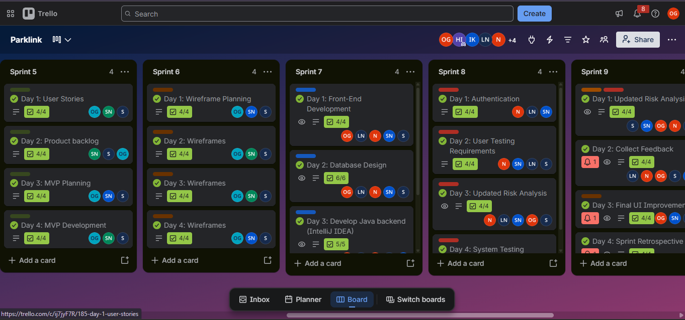

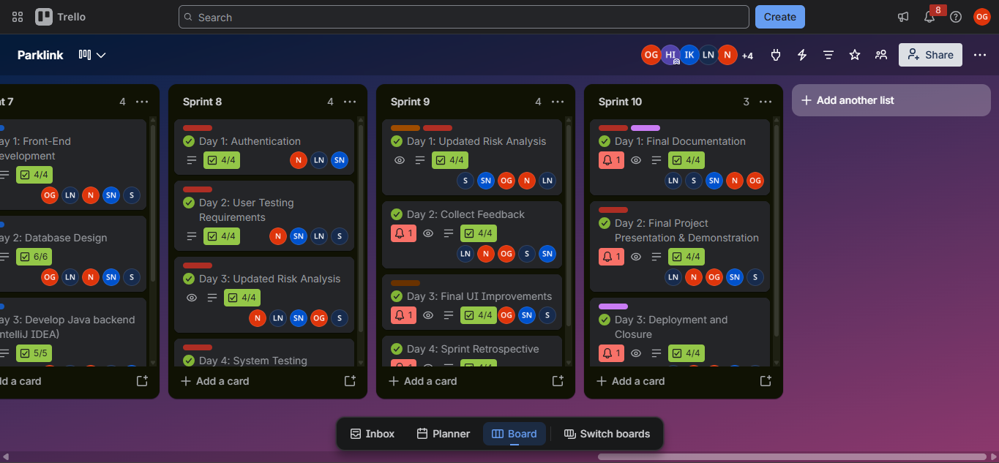

| Sprint | Focus | Day | Task card | Checklist | Assigned |
| --- | --- | --- | --- | --- | --- |
| **Sprint 5** | Planning the product | Day 1 | User Stories | 4/4 | OG, SN, S |
| | | Day 2 | Product backlog | 4/4 | SN, S, OG |
| | | Day 3 | MVP Planning | 4/4 | OG, SN, S |
| | | Day 4 | MVP Development | 4/4 | OG, SN, S |
| **Sprint 6** | Design | Day 1 | Wireframe Planning | 4/4 | OG, SN, S |
| | | Day 2 | Wireframes | 4/4 | OG, SN, S |
| | | Day 3 | Wireframes | 4/4 | OG, SN, S |
| | | Day 4 | Wireframes | 4/4 | OG, SN, S |
| **Sprint 7** | Build | Day 1 | Front-End Development | 4/4 | OG, LN, N, SN, S |
| | | Day 2 | Database Design | 6/6 | OG, LN, N, SN, S |
| | | Day 3 | Develop Java backend (IntelliJ IDEA) | 5/5 | See screenshot |
| **Sprint 8** | Secure and test | Day 1 | Authentication | 4/4 | N, LN, SN |
| | | Day 2 | User Testing Requirements | 4/4 | N, SN, LN, S |
| | | Day 3 | Updated Risk Analysis | 4/4 | N, LN, SN, OG, S |
| | | Day 4 | System Testing | Complete | See screenshot |
| **Sprint 9** | Refine | Day 1 | Updated Risk Analysis | 4/4 | S, SN, OG, N, LN |
| | | Day 2 | Collect Feedback | 4/4 | LN, N, OG, S, SN |
| | | Day 3 | Final UI Improvements | 4/4 | OG, SN, S |
| | | Day 4 | Sprint Retrospective | Complete | See screenshot |
| **Sprint 10** | Close | Day 1 | Final Documentation | 4/4 | LN, S, SN, N, OG |
| | | Day 2 | Final Project Presentation & Demonstration | 4/4 | LN, N, OG, SN, S |
| | | Day 3 | Deployment and Closure | 4/4 | See screenshot |

**Team member initials:** OG = Onika Gobane, HI = Hillary Itlhabanyeng, IK = Inam Klaas, LN = Liyabona Ngece, N = Nondumiso Ngobese, SN = Sesethu Nciti, S = Siphesihle Khinase.  
Sprint 7 has four cards, and the fourth is below the visible area of the screenshots.

### Front-end build sprint in detail (28 July to 7 August 2026, from the logbook)

The logbook's taskboard snapshot numbered this sprint differently from our final Trello board, where the front-end work sits in Sprint 7.

- **Sprint goal:** Set up the GitHub repository and build the core front-end screens in React from our 17-screen wireframe set.  
- **Live board:** [PartLink Trello Board](https://trello.com/b/PmNt1Ast/parklink)  
- **Ceremonies:** daily stand-ups and the weekly Thursday review from our charter.  

| Day | Sprint task | Date | Status |
| --- | --- | --- | --- |
| Day 1 | Create the GitHub repository and project structure | 28/07/2026 | Complete |
| Day 2 | Build Landing Page, Home/Products, About Us and Contact Us in React | 29/07/2026 | Complete |
| Day 3 | Build Registration, Login, Reset Password and Profile in React | 30/07/2026 | Complete |
| Day 4 | Build Car Part Listing, Car Part Details, Cart and Checkout in React | 31/07/2026 | Complete |
| Added | Build Settings, View Listing and Edit Listing in React | 31/07/2026 | Complete |
| Added | Design a colour palette page (assigned by our lecturer) | 05/08 to 06/08/2026 | Complete |

**Changes during the sprint**

- **31/07/2026:** lecturer feedback asked for a colour palette page, which was added to the sprint.  
- **04/08/2026:** Hillary left the group, I became team lead and her cards were reassigned.  
- **05/08/2026:** the brand colour palette, logo usage and typography were finalised so the palette page could be built.  
- **07/08/2026:** Liyabona Ngece joined the team and was assigned to upcoming back-end integration tasks.  

**Project outcome (as at 27 October 2026):** after the front-end build the team completed the remaining sprints, up to Sprint 10 (Deployment and Closure), and deployed the PartLink website. The website is live and working.

### Front-end sprint review (based on the logbook)

| What went well | What did not go well | What we would change |
| --- | --- | --- |
| The core screens were built on the planned days (28/07 to 31/07) | Styling consistency took longer than expected (30/07) | Agree shared styles and reusable components before building more screens |
| The colour palette page was finished within two days of starting it | The palette needed several rounds of revision (05/08) | Agree brand decisions with the whole team earlier |
| The team regrouped quickly after a member left (04/08) | Redistributing tasks and choosing a lead took most of a day (04/08) | Keep Trello assignments current so tasks can be handed over faster |
| A new member was welcomed and onboarding was planned (07/08) | The workload was heavier with only three members (06/08) | Assign back-end tasks early so the new member can contribute |

## Reflection: Sprint Backlog (STAR Method)

### Situation  
By the start of the front-end build, research, wireframes and the MVP plan were complete, and the next step was to start building. The wireframes gave us a clear guide, so the plan was to build the screens in order, a few each day, with the 17-screen set as our target. The challenge was to turn that large goal into small daily tasks that the team could finish and show on the board.

### Task  
My task was to help plan the sprint, assign the work and keep the board updated as tasks were completed. I worked on React front-end screens and the colour palette page. From 4 August I was also responsible for keeping the team organised as team lead, which meant making sure the sprint kept moving after a member left.

### Action  
- Planned one group of screens per day: the repository on Day 1, the public pages on Day 2, the account screens on Day 3, and the listing, cart and checkout screens on Day 4.  
- Worked on React screens from our wireframes and on the colour palette page, and updated the board as each task was finished.  
- Added the Settings, View Listing and Edit Listing screens and the colour palette page to the sprint when they were needed.  
- Recorded the problems that came up each day (folder structure, reusable components and styling) so they could be solved quickly.  
- Updated the board and sprint plan on 4 August after the team changed, so that Hillary's outstanding work was visible and reassigned.  
- Prepared for Liyabona's arrival on 7 August by updating Trello and planning her onboarding and back-end tasks.  
- Worked through the daily cards for Sprints 5 to 10 on Trello, ticking off each checklist as the tasks were completed.  

### Result  
The core front-end screens were completed on the planned days, and the sprint adapted to a new request and a team change. By 7 August the main screens from our wireframes were built and the colour palette page was finished. This taught me that a plan needs room for new requests and team changes, because two unplanned things (the lecturer's palette page and Hillary leaving) both landed in the same sprint. Because the front-end was finished on time, the team could move on to back-end integration and finally deploy a working website. Looking back, I would estimate every task before each sprint starts, so the plan reflects how long the work will really take. I would also agree the API structure before the back-end integration sprint, because connecting the front-end to the Java back-end depends on it.

---

## What Was Easy and What Was Difficult

**Easy**  
- Planning one group of screens per day, because the wireframes were already finished and told us exactly what to build.  
- Showing progress, because completed screens could be moved to Completed on the board straight away.  

**Difficult**  
- Keeping the board and documents up to date while the plan was changing. In a single week the plan changed three times (the added screens, the palette page and the team change), and each change had to be reflected in Trello, the logbook and our documents.  
- Keeping the sprint on track while the team shrank to three members and a new lead had to be agreed, because redistributing tasks took most of one working day.  

---

# Agile Logbook (PartLink Project)

## Evidence: Daily Logbooks and Taskboard Workflow

An Agile logbook records the team's daily stand-ups, sprint plans and retrospective notes. Each entry answers three questions: what did I complete since the last stand-up, what am I planning before the next one, and what are my impediments (risks or problems).

- **Period covered:** 28 July to 7 August 2026 (the front-end build sprint), with eight stand-up entries. This is the sprint in which we built the front-end. The team completed the remaining work and deployed the website after this period.  
- **Taskboard walkthrough:** each logbook also records a taskboard snapshot and four questions about the work.
  
   
###  Agile Logbook, Part 1

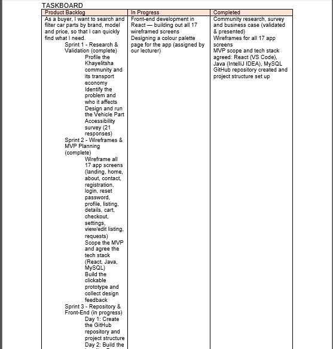

###  Agile Logbook, Part 2

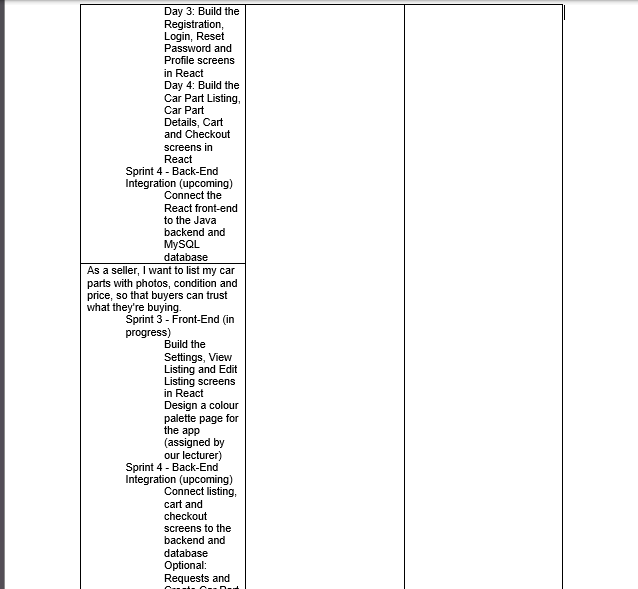

###  Agile Logbook, Part 3

###  Agile Logbook, Part 4 

### Logbook summary

| Date | Key outcome | Main impediment |
| --- | --- | --- |
| 28/07 | GitHub repository and project structure created | Folder structure and branching strategy |
| 29/07 | Landing, Home/Products, About Us and Contact Us built | Reusable React components |
| 30/07 | Registration, Login, Reset Password and Profile built | Consistent styling |
| 31/07 | Core front-end pages complete; lecturer feedback received | None major |
| 04/08 | Team regrouped after a member left; Trello reassigned | Redistributing tasks and choosing a lead |
| 05/08 | Brand colour palette, logo usage and typography finalised | Palette revisions |
| 06/08 | Colour palette page completed | Heavier workload with three members |
| 07/08 | New member welcomed; Trello updated | Getting the new member up to speed |

### Taskboard walkthrough (recorded during the front-end build)

| Question | Answer |
| --- | --- |
| What do we need to do to advance this piece of work? | Finish building the remaining React screens from the wireframes and get ready to connect them to the Java backend and MySQL database |
| Is anyone working on anything that is not on the board? | No. All repository and front-end work is tracked on the board and committed to GitHub |
| What do we need to finish as a team? | Finish the remaining screens and agree the API structure before starting backend integration |
| Are there any bottlenecks or blockers? | None major. Mostly getting everyone comfortable with the Git workflow and React component structure |

### Patterns in the logbook
- **Technical blockers were early and practical.** In the first week the impediments moved from folder structure and branching (28/07) to reusable React components (29/07) to consistent styling (30/07). Each one was raised in the stand-up and then no longer appeared, which shows the agreement to raise blockers early working.  
- **The second week was about the team.** The impediments on 4, 6 and 7 August were all about people and workload: redistributing tasks, a heavier load with three members, and onboarding a new member.  
- **Plans matched outcomes.** Each day's "planned" answer became the next day's "completed" answer, from the repository on 28 July to the Cart and Checkout screens on 31 July.  

## Reflection: Agile Logbook (STAR Method)

### Situation  
The Agile method relies on a team being honest and regular about its progress, plans and problems, and the logbook is the evidence of that. We kept it through the front-end build sprint, a sprint in which the team also changed. It was important that the records were accurate, because the logbook is our evidence of how the team worked, and because the team members who were reading it needed to trust what it said.

### Task  
My task was to record the stand-ups honestly, track our work against the taskboard, and log the blockers and team changes. I wrote entries in the logbook for our stand-ups, and I also had to make sure the logbook agreed with what the Trello board showed.

### Action  
- Recorded daily stand-ups using the three Agile questions, so each entry said what was done, what was planned and what was blocking us.  
- Logged blockers as they came up, such as folder structure and branching on 28 July, React components on 29 July and styling consistency on 30 July.  
- Recorded the team change on 4 August, when Hillary left, I stepped up as team lead and Trello was updated. I recorded the Trello updates I made on 4 August in the logbook.  
- Recorded the progress on the colour palette page across 5 and 6 August, including the palette revisions that slowed us down.  
- Recorded the welcome and onboarding plan for Liyabona on 7 August, so the next sprint's tasks were already linked to a person.  
- Kept a taskboard snapshot and walkthrough in each logbook, so the written entries and the board could be checked against each other.  

### Result  
The logbook showed how our team worked day to day and how it handled change. It also showed which problems kept coming back, such as styling consistency and React components, and that raising them in the stand-up helped us deal with them before they grew. I learned that a logbook is only useful if it is kept up to date every day, alongside the board and our documents, because a gap in one of them makes the others harder to trust. If I did this again I would estimate tasks before each sprint and record those estimates in the logbook, so that the plan, the progress and the time taken can be compared. I would also record decisions, such as who took over which cards on 4 August, as well as tasks.

---

## What Was Easy and What Was Difficult

**Easy**  
- Answering the three stand-up questions each day, because they gave every entry a clear structure and made it quick to write.  
- Linking each entry to the board, because the screens built each day were already listed as tasks.  

**Difficult**  
- Keeping the logbook, Trello and our documents up to date at the same time. A change in one, such as the team change on 4 August, meant updating the other two, and it took discipline to do all three on the same day.  
- Recording enough detail about team changes. The 4 August entry had to explain who left, who became lead and how cards were reassigned, without it becoming too long to read.
